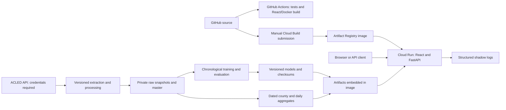

# K-PVIEWS

**Kenya Political Violence & Event Severity Intelligence Platform** is an academic research
application for exploring recorded violence, assessing event severity and examining separate
county-level seven-day forecasts. React + TypeScript provides the interface; FastAPI serves
predictions and bounded aggregate data.

- **Canonical repository:** [lucasWAFULA/Capstone-Kenya-Polit-violence](https://github.com/lucasWAFULA/Capstone-Kenya-Polit-violence)
- **Public demonstration:** https://kenya-event-severity-clabrcsgmq-bq.a.run.app
- **Final report:** [FINAL_REPORT.md](FINAL_REPORT.md)
- **AI disclosure:** [AI_USE.md](AI_USE.md)

Website and API access are public as of 21 November 2026. ACLED ingestion still requires
separate data-provider credentials. Historical results are labelled; public hosting does not
make the source data current.

## Submission checklist

| Required component | Repository evidence |
| --- | --- |
| Overview, setup, architecture and reproduction | This README |
| AI assistance disclosure | [AI_USE.md](AI_USE.md); student must verify the course policy |
| Scripted data pipeline | [fetch_acled_data.py](scripts/fetch_acled_data.py), [build_county_daily.py](scripts/build_county_daily.py), [source modules](src/severity_service) |
| Training and serialized models | [train_production_models.py](scripts/train_production_models.py), [train_forecasting.py](scripts/train_forecasting.py), [production registry](artifacts/production), [forecast artifacts](artifacts/forecasting) |
| Docker and Compose | [Dockerfile](Dockerfile), [compose.yaml](compose.yaml), [Dockerfile.reporting](Dockerfile.reporting) |
| API service | [app.py](src/severity_service/app.py), [schemas.py](src/severity_service/schemas.py), [tests](tests) |
| Final report | [FINAL_REPORT.md](FINAL_REPORT.md), with [FORECASTING_RESULTS.md](FORECASTING_RESULTS.md) |

`compose.yaml` is the equivalent of `docker-compose.yml`. The final report is GitHub-readable
Markdown; no PDF, Word report or slide deck is claimed.

## Product and models

Seven React sections cover executive overview, individual/JSON batch severity assessment,
forecasts and trends, geographic intelligence, alerts and review, data exploration, and model
governance. Features include a local 47-county map, verified historical charts, county/window
filters, CSV/JSON exports, responsive navigation and light/dark themes.

Keep these evidence types separate:

1. **Observed activity:** recorded counts and outcomes with dated coverage and reporting restrictions.
2. **Event severity:** Logistic Regression returns Low (0 fatalities), Moderate (1–2) or High
   (3+) and class probabilities. XGBoost scores in shadow mode only.
3. **County forecasts:** a separate Random Forest research model estimates at least one
   high-severity political violence event in the next seven days.

Fatalities define outcomes and appear in descriptive statistics; current-event fatalities are
never accepted as predictors. The severity API requires six caller-supplied historical values
from eligible records strictly before the event date. Automatic dated-snapshot lookup is not
implemented. Unknown history must not be replaced with zero.

## Architecture



Models and approved aggregates are packaged in the image. Cloud Storage model/feature
loading remains future work. Private raw data and SQLite state are excluded from deployment;
Cloud Run's local filesystem is ephemeral, not durable shared ingestion storage. The GitHub
workflow tests and builds; the deploy script explicitly submits Cloud Build. A repository
deployment trigger is not claimed.

## Run from a fresh clone

Prerequisites: Git, Python 3.13 and Node.js 24/npm. Docker is optional for native startup.

```powershell
git clone https://github.com/lucasWAFULA/Capstone-Kenya-Polit-violence.git
cd Capstone-Kenya-Polit-violence
py -3.13 -m venv .venv
.\.venv\Scripts\Activate.ps1
python -m pip install -r requirements.txt
npm ci --prefix frontend
npm run build --prefix frontend
$env:PYTHONPATH = "$PWD/src"
python -m uvicorn severity_service.app:app --host 127.0.0.1 --port 8000
```

Open http://localhost:8000. Committed artifacts allow serving without raw training data or
ACLED credentials. `/event-assessment` opens severity assessment; `/docs` exposes OpenAPI.
In another activated terminal, run `python -m pytest -q`. Startup checks model checksums,
feature names and class order. For React development, start FastAPI on **8765**, then run
`npm run dev --prefix frontend` and open Vite's printed address at `/ui/`.

Generated frontend assets under `src/severity_service/static/ui/` are ignored by Git and
rebuilt by Docker from committed source and `frontend/package-lock.json`.

## Reproduce the pipeline and experiments

Raw ACLED exports, credentials, processed masters and local SQLite stores are excluded from
Git. Obtain authorized ACLED access and respect its usage conditions. Fresh API responses can
differ because of revisions, dates and account restrictions. Exact experiment replication
requires the same frozen input export and pinned dependencies; querying the API again alone
does not guarantee identical results.

### Historical extraction and daily panel

Copy `.env.example` to ignored `.env` and enter your ACLED credentials in your editor. Then:

```powershell
python scripts/check_acled_api.py
python scripts/fetch_acled_data.py
python scripts/inspect_acled_data.py
python scripts/build_county_daily.py
python scripts/package_activity_map.py
python scripts/package_dashboard_activity.py --source-root .
```

Extraction preserves raw pages, hashes and quality reports before atomically updating the
latest pointer. The daily build produces the complete 47-county calendar, historical lags
and censored seven-day labels. Packaging requires the daily series and packaged summary to
have matching source-run IDs. Only bounded aggregate chart fields are packaged. See
[HISTORICAL_INGESTION.md](HISTORICAL_INGESTION.md) and [DAILY_DATASET.md](DAILY_DATASET.md).

### Event severity training

```powershell
python scripts/train_production_models.py --data 'PATH_TO_FROZEN_EXPORT.csv' --output artifacts/production --version 1.0.1
```

The script trains before 2022, evaluates on 2022–2023 and 2024 onward, then refits both
governed candidates on all input records for serving. Outputs include serialized pipelines,
`model_metrics.csv` and the checksum manifest. Holdout metrics describe the chronological
experiment, not independent evaluation of the final all-data refit.

### Separate forecasting experiment

```powershell
python scripts/train_forecasting.py --data 'PATH_TO_FROZEN_EXPORT.csv' --coverage-end 2025-09-07 --reporting-delay-days 7 --output artifacts/forecasting
```

Use the export's actual final fully observed date. Repeat delays 0 and 14 in separate output
directories for sensitivity analysis. Rolling 2019–2021 validation selects the model; fitting,
calibration, threshold selection and testing use separate chronological periods with horizon
and reporting-delay purging. See [FORECASTING_RESULTS.md](FORECASTING_RESULTS.md).

`update_reporting.py` updates descriptive reporting; `update_forecasts.py` updates forecasts
without retraining. Freshness/access gates apply. See [REPORTING_READINESS.md](REPORTING_READINESS.md)
and [LIVE_OPERATIONS.md](LIVE_OPERATIONS.md). The packaged forecast is historical, not a current alert stream.

## API service

| Endpoint | Purpose |
| --- | --- |
| `/health/live`, `/health/ready` | Process and model readiness |
| `POST /v1/predict` | Individual severity prediction; `/predict` is an alias |
| `POST /v1/predict/batch` | 1–1,000 objects inside an `events` array |
| `/v1/forecasts`, `/v1/alerts` | Dated forecasts and eligible research signals |
| `/v1/data/map?days=90` | County counts; supported windows 7/30/90/365 |
| `/v1/data/summary`, `/v1/data/daily?county=Nairobi&days=90` | Quality metadata and daily aggregates |
| `/v1/reporting/status` | Source-access and reporting evidence |
| `/v1/models/info` | Model metadata and evaluation metrics |

Illustrative input, not a verified incident:

```json
{
  "event_date": "2025-09-01",
  "disorder_type": "Political violence",
  "event_type": "Battles",
  "sub_event_type": "Armed clash",
  "admin1": "Nairobi",
  "admin2": "Nairobi",
  "inter1": 1,
  "interaction": 12,
  "civilian_targeting": null,
  "county_events_previous_30_days": 8,
  "county_events_previous_90_days": 20,
  "violent_events_previous_30_days": 4,
  "previous_high_severity_events_in_county": 1,
  "days_since_previous_event_in_county": 2,
  "actor_previous_event_count": 15
}
```

Responses contain `request_id`, `severity`, `probabilities`, `model_name` and `model_version`.
Unknown fields, including `fatalities`, and missing historical values are rejected.
`previous_high_severity_events_in_county` uses the previous 90 days.

## Containers and cloud deployment

```powershell
docker compose up --build -d
# Open http://localhost:8000
docker compose down
```

Optional `live` and `reporting` profiles require `.env` and use named local volumes.
The Dockerfile builds React with Node 24 and runs FastAPI as a non-root user.

The deployed project is `k-pviews-2026`, region `africa-south1`, service `kenya-event-severity`.
For a new authorized billing-enabled project, bootstrap once, then deploy:

```powershell
gcloud auth login
.\deploy\gcp\bootstrap.ps1 -ProjectId 'YOUR_PROJECT_ID'
.\deploy\gcp\deploy.ps1 -ProjectId 'YOUR_PROJECT_ID'
```

**Public access is the configured default**, matching the published demonstration. Use
`-Private` to disable public invocation. The older `-AllowUnauthenticated` switch remains
supported. Direct Cloud Build submissions can override `_ACCESS_FLAG` with
`--no-allow-unauthenticated`. The configuration uses 1 CPU/1 GiB, concurrency 20, up to five
instances per revision and immutable Build-ID image tags.

Run `deploy/gcp/smoke-test.ps1 -ServiceUrl 'SERVICE_URL'` after deployment. Browser checks in
`scripts/qa_react.cjs` use headless Chrome's DevTools port 9224; `KPVIEWS_QA_URL` selects a
public service or authenticated proxy. On 21 November 2026, 44 backend tests and deployed
browser checks passed. These verify software behavior, not operational model validity.

## Limitations and monitoring

- Forecasts are retrospective research with a high false discovery rate; stale/historical
  forecasts suppress current signals. No operational forecasting validation is claimed.
- Missing reports are not proof of no violence. Delays, account access and revisions affect coverage.
- Severity history remains caller-supplied. Cloud Storage lookup, durable cloud ingestion,
  persistent reviewer notes, application roles and rate limiting are future work.
- Predictions support human assessment. Shadow logs are emitted; monthly label joins,
  calibration/drift dashboards and challenger promotion automation are not claimed.
- Review [FINAL_REPORT.md](FINAL_REPORT.md) and [AI_USE.md](AI_USE.md) against the course rubric before submission.
